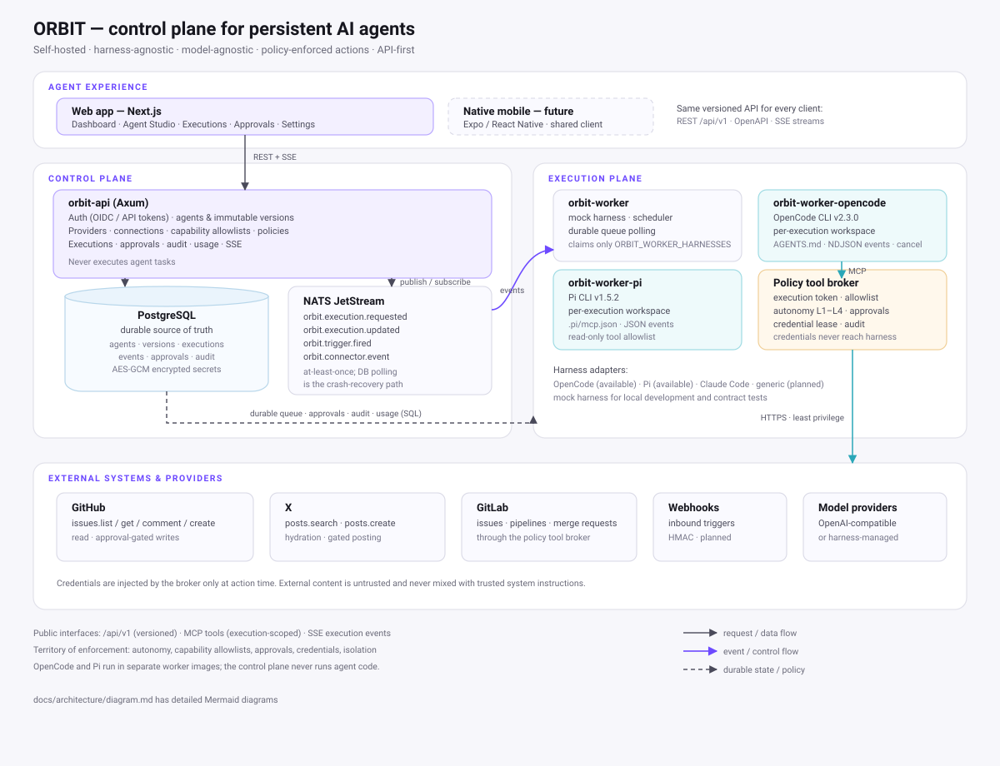
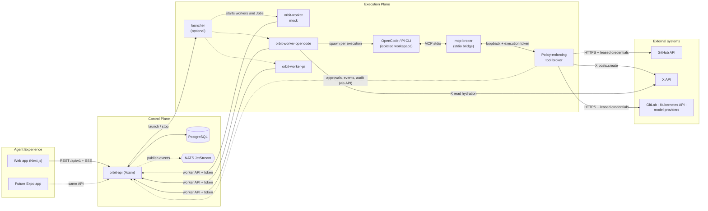
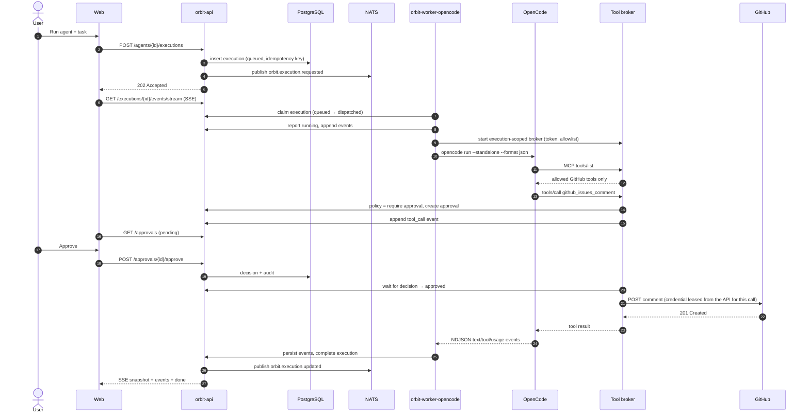
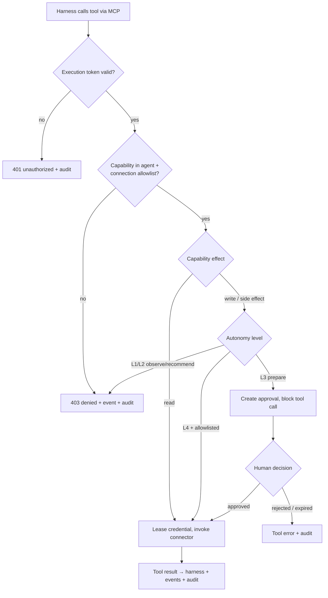
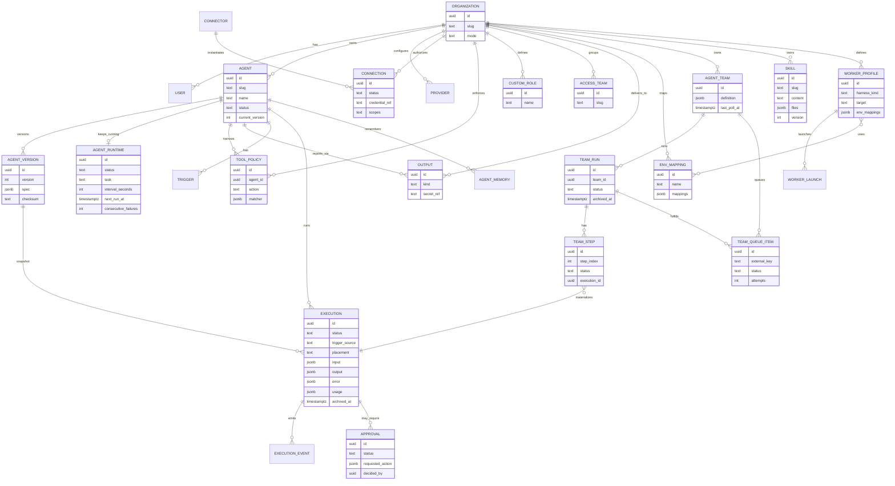
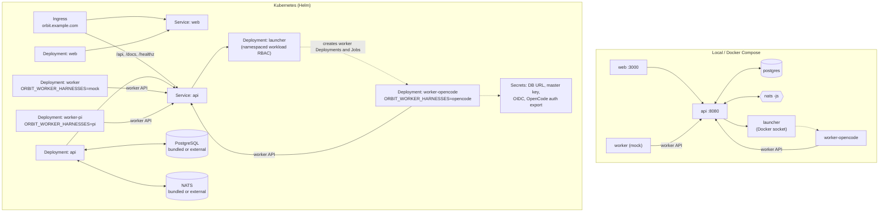

# ORBIT architecture diagrams

The image follows the reader's light or dark colour scheme. A light PNG export is at
[`orbit-overview.png`](orbit-overview.png); regenerate it when the SVG changes.

## Reading the diagram

| Part | What it shows |
|---|---|
| **Web app, API clients** | Everything enters through the versioned REST API (`/api/v1`) with an OIDC session or an API token. Runs stream back as server-sent events. |
| **Control plane** | `orbit-api` holds the definitions, the run queue, schedules, policy, approvals, secrets and the audit log, and runs the background loops. PostgreSQL is the source of truth. NATS JetStream carries event notifications; nothing depends on it for correctness. The API also delivers outputs and reads the issue queues that feed agent teams. |
| **Trust boundary** | The API never calls a worker. A worker holds one scoped, revocable token and uses the worker API to claim runs, fetch what a run needs and report events. It has no database, event bus or master-key access. The API does call the launcher, to start and stop workers. |
| **Execution plane** | `orbit-launcher` starts workers on Docker or Kubernetes. `orbit-worker` runs the harness (OpenCode, Pi, or the mock for testing) in a workspace of its own per run. The harness calls the model provider itself. Connector tools go over MCP to the tool broker, which checks the allowlist, the autonomy level and any approval, then leases the credential for that one call. See [Execution Plane](execution-plane.md). |
| **Outside ORBIT** | Dashed boxes are systems ORBIT talks to but does not run: outputs, issue queues, model providers and connectors. |
| **Numbers 1 to 6** | The life of one run, repeated in the strip under the diagram. |

| Status | Components |
|---|---|
| **Implemented** | API, PostgreSQL schema, NATS/memory bus, mock harness, OpenCode v2.3.0, Pi v1.5.2, X read hydration and posting, SSE, audit, encrypted secrets, tool broker and tool policies, GitHub and GitLab connectors (approval-gated writes), read-only Kubernetes connector, approval UI, Agent Teams (queue, dispatcher, multi-repo, close-the-loop), continuous agent runtime, memory, launcher and K8s Jobs, OIDC, custom roles, access teams and sharing, webhook/Slack/Mattermost/Telegram outputs, offline licensing, custom CA, dark/light mode, env var mappings, scripts in skills, per-agent models, Work wizard |
| **Planned** | Inbound webhooks (webhook and event triggers are stored but never fire), Telegram and webhook connector invocation, large-scale simulation runs, Claude Code adapter |

## System context

## Execution sequence (manual run with a GitHub write)

## Tool broker decision path

## Domain model

## Deployment topology

## Boundaries that keep the design honest

1. **The control plane never runs agent code.** Only workers and harness containers do.
2. **PostgreSQL is the source of truth.** The event bus is an accelerator, not a queue you can lose.
3. **Policy and approvals live outside the model.** Prompts are not a security boundary.
4. **Credentials are leased by the broker per action**, never embedded in prompts, CLI arguments or tool output.
5. **Agent versions are immutable.** Running executions keep the version they started with.
6. **Workers are harness-scoped.** The mock worker cannot claim OpenCode executions and vice versa.
7. **External content is untrusted.** Trusted instructions travel separately from retrieved data.
